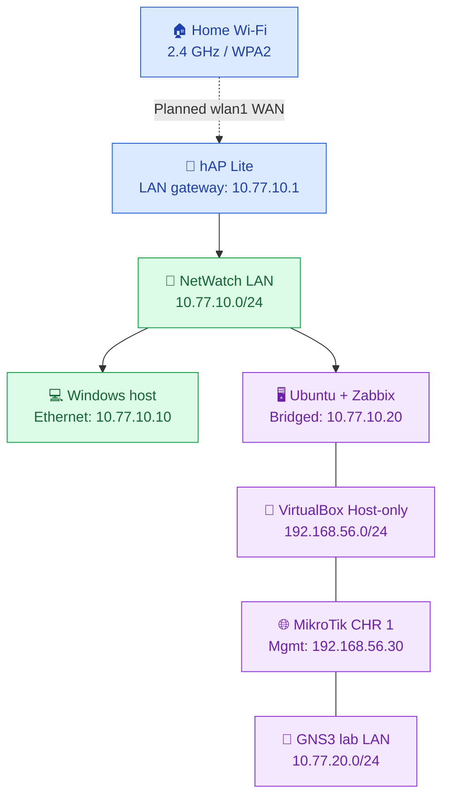

# 📡 NetWatch NOC
### Network Monitoring & Incident Management Lab

  

**MikroTik · GNS3 · VirtualBox · Ubuntu Server · Zabbix**

*A documented network operations home lab, progressing from infrastructure assessment to monitoring, alerting and incident response.*

[Architecture](docs/ARCHITECTURE.md) · [IP Plan](docs/IP-PLAN.md) · [Roadmap](docs/ROADMAP.md) · [Progress](docs/PROGRESS.md)

> [!IMPORTANT]
> **Current stage: Phase 0 review.** Hardware assessment and initial network planning are complete. The repository and LinkedIn project have been reported as published; the practical documentation audit and formal phase closure remain pending. No custom hAP Lite deployment or Zabbix monitoring has been verified.

## 🧭 Project at a glance

| 🎯 Purpose | 🧪 Environment | 🔎 Monitoring targets |
|:---|:---|:---|
| Build a testable network monitoring and incident-response lab | Physical MikroTik + virtual Linux/RouterOS systems | ICMP/SNMP, availability, interfaces, CPU, memory and uptime when supported |
| **🛠 Stack** | **📋 Delivery** | **🔐 Publication** |
| RouterOS, GNS3, VirtualBox, Ubuntu Server, Zabbix | 7 phases, 29 subphases, review at each milestone | Sanitized configs and evidence; no device backups or secrets |

## 📍 Project status

| Stage | Status | Outcome |
|:---|:---|:---|
| ✅ **0.1 · Environment inventory** | Completed | Hardware/software inventory; capacity risks noted |
| ✅ **0.2 · Physical router assessment** | Completed | RouterOS, interface, DHCP and firewall baseline reviewed |
| ✅ **0.3 · Architecture planning** | Planned baseline | Logical topology, addressing and resource proposals |
| 🟡 **0.4 · Repository baseline** | Reported published; audit pending | Initial documentation and GitHub/LinkedIn reported complete |
| ⚪ **1–6 · Implementation to release** | Not started | Connectivity, Zabbix, CHR monitoring, incidents and final validation |

## 🗺️ Proposed network architecture

> [!NOTE]
> Diagram ini menunjukkan **rencana logis**, bukan bukti konektivitas. Ubuntu berjalan di laptop Windows; tidak membutuhkan kabel Ethernet terpisah. Jalur internet, mode bridge, Host-only dan return routing baru akan dibuktikan pada fase implementasi.

## 📚 Documentation hub

| 🏗️ Design & governance | 📍 Implementation & tracking |
|:---|:---|
| [🗺️ Architecture](docs/ARCHITECTURE.md) | [📊 Progress log](docs/PROGRESS.md) |
| [🧮 IP addressing plan](docs/IP-PLAN.md) | [🧪 Phase 0 assessment](docs/phases/PHASE-0-ASSESSMENT.md) |
| [🎯 Project scope](docs/SCOPE.md) | [🧭 Roadmap](docs/ROADMAP.md) |
| [📝 Architecture decisions](docs/DECISIONS.md) | 🔜 Deployment evidence and tested configurations (later phases) |

## 🔬 Testing and reproducibility

| Available now | Planned after implementation |
|:---|:---|
| Architecture, addressing proposal, requirements and design decisions | Validated MikroTik `.rsc` examples, GNS3 rebuild instructions, Zabbix setup, connectivity and incident tests |

> [!CAUTION]
> Raw `.backup`, unreviewed `.rsc`, passwords, Wi-Fi keys, SNMP secrets, private keys, identifying device details and VM disk images are **not included**. A public `.rsc` must be sanitized **and** verified on a clean lab before being labeled reusable.

**Project classification:** Educational home lab · **Not production-ready** · Results are published only after verification.
