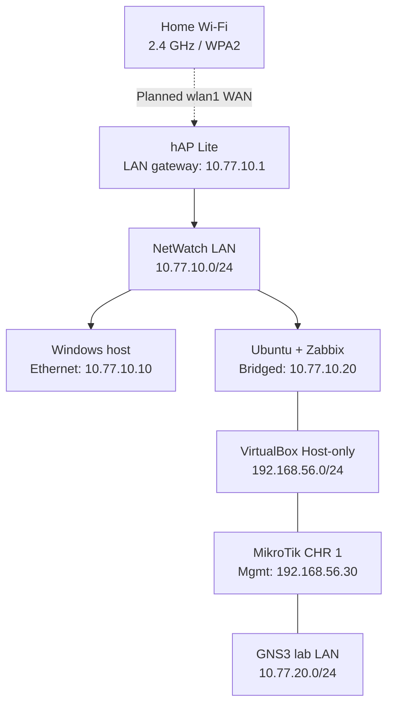

# NetWatch NOC

**Network monitoring and incident management lab with MikroTik, GNS3, Ubuntu Server, and Zabbix**

[Architecture](docs/ARCHITECTURE.md) · [IP Plan](docs/IP-PLAN.md) · [Roadmap](docs/ROADMAP.md) · [Progress](docs/PROGRESS.md)

## Overview

NetWatch NOC is a home lab for practising network operations: monitoring devices, raising alerts, and handling incidents end to end. It combines a physical MikroTik hAP Lite, virtual MikroTik CHR routers in GNS3, and a Zabbix server on Ubuntu.

The project is delivered in seven phases, from infrastructure assessment to a final demonstration. Each phase ends with a review, and results are published only after they have been tested.

> [!IMPORTANT]
> **Current stage: Phase 1.1 — Physical Connection.** Phase 0 (inventory, router assessment, architecture planning, and repository baseline) is complete. Custom RouterOS configuration and the Zabbix installation have not started yet.

## Goals

| Area | Target |
|---|---|
| **Monitoring** | ICMP and SNMP checks for availability, interfaces, CPU, memory, and uptime where the device supports them |
| **Alerting** | Zabbix triggers, dashboards, and notifications |
| **Incidents** | Controlled outages, investigation, and recovery testing |
| **Documentation** | Reproducible setup with sanitized configurations and test evidence |

**Stack:** MikroTik RouterOS (hAP Lite and CHR), GNS3, Oracle VirtualBox, Ubuntu Server, Zabbix.

## Progress

| Phase | Scope | Status |
|---|---|---|
| **0 · Governance & assessment** | Inventory, physical router assessment, architecture plan, repository baseline | Completed |
| **1 · Network preparation** | Physical connection, router setup, connectivity, security and backup | In progress (1.1) |
| **2 · Zabbix deployment** | Ubuntu VM, networking, Zabbix installation and validation | Not started |
| **3 · Physical monitoring** | SNMP, host integration, dashboard for the hAP Lite | Not started |
| **4 · Virtual network** | CHR topology in GNS3, multi-device monitoring | Not started |
| **5 · Incidents** | Triggers, alerts, outage simulations, recovery | Not started |
| **6 · Final release** | Acceptance tests, documentation review, demonstration | Not started |

Details for each subphase are in the [roadmap](docs/ROADMAP.md) and [progress log](docs/PROGRESS.md).

## Planned Architecture

This diagram is the planned logical design, not tested connectivity. Ubuntu runs as a VM on the Windows laptop, so it needs no separate Ethernet cable. The Wi-Fi WAN, bridged and host-only networking, and return routing will be validated during implementation.

## Documentation

| Design | Tracking |
|---|---|
| [Architecture](docs/ARCHITECTURE.md) | [Progress log](docs/PROGRESS.md) |
| [IP addressing plan](docs/IP-PLAN.md) | [Phase 0 assessment](docs/phases/PHASE-0-ASSESSMENT.md) |
| [Project scope](docs/SCOPE.md) | [Phase 1 plan](docs/phases/PHASE-1-NETWORK-LAB.md) |
| [Architecture decisions](docs/DECISIONS.md) | [Roadmap](docs/ROADMAP.md) |

Tested RouterOS `.rsc` examples, GNS3 rebuild steps, the Zabbix setup guide, and incident test results will be added as each phase is completed.

## Scope

**Out of scope:** high-availability clusters, paid cloud infrastructure, production-scale BGP/OSPF, full SIEM/SOC tooling, and alternative monitoring stacks such as Prometheus/Grafana or LibreNMS. The full list is in [SCOPE.md](docs/SCOPE.md).

**Not published:** device backups, unreviewed RouterOS exports, passwords, Wi-Fi keys, SNMP secrets, private keys, identifying device details, and VM disk images. Any `.rsc` shared here is sanitized and verified on a clean lab first.

This is an educational home lab, not a production-ready system.
