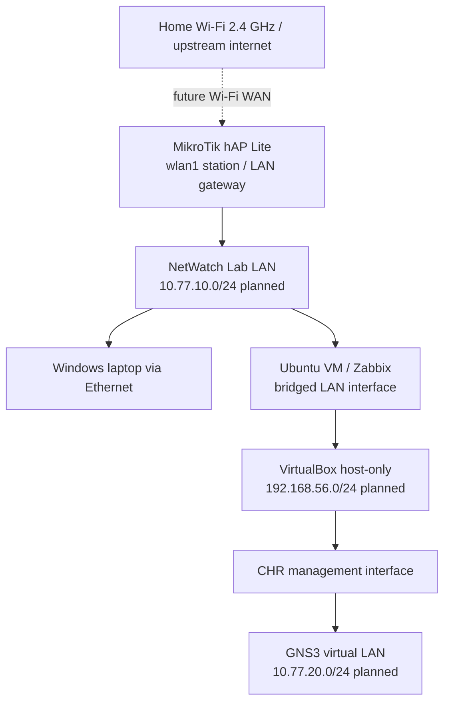

# NetWatch NOC — Network Monitoring & Incident Management Lab

> **Status: Work in Progress — Phase 0 baseline prepared (not yet deployed).**

A reproducible home-lab project for learning network operations using a physical MikroTik hAP Lite, MikroTik CHR virtual routers, Ubuntu Server 24.04 LTS, Zabbix 7.0 LTS (subject to installation compatibility verification), VirtualBox, and GNS3.

## Goals

Build and validate a small network monitoring environment covering ICMP/SNMP availability, device and interface metrics, dashboards, alerts, controlled incident simulation, troubleshooting, recovery verification, and technical documentation.

## Current progress

- **Phase 0.1:** Host inventory completed; RAM and storage capacity risks identified.
- **Phase 0.2:** Physical MikroTik assessment completed; configuration reviewed and local backup/export reported.
- **Phase 0.3:** Initial architecture and IP plan drafted; implementation not yet verified.
- **Phase 0.4:** Repository and baseline documentation in progress.
- **Phases 1–6:** Not started.

## Planned architecture

*Dashed link and all IP addresses represent design intentions, not verified connectivity. The VM will have separate bridged and host-only adapters as planned.*

## Project documentation

- [Roadmap](docs/ROADMAP.md)
- [Scope](docs/SCOPE.md)
- [Architecture](docs/ARCHITECTURE.md)
- [IP addressing plan](docs/IP-PLAN.md)
- [Progress](docs/PROGRESS.md)
- [Decisions](docs/DECISIONS.md)
- [Phase 0 assessment summary](docs/phases/PHASE-0-ASSESSMENT.md)

## Reproducibility plan

Sanitized/tested MikroTik `.rsc` configuration examples, GNS3 topology guidance, installation procedures and test cases will be added *after* implementation. No raw device backup, raw export, passwords, Wi-Fi credentials, private keys, or VM disk images are published.

## Disclaimer

Educational lab, not production-ready. Features and test results are only claimed once verified. No public credentials or private infrastructure details are required to understand this repository.
