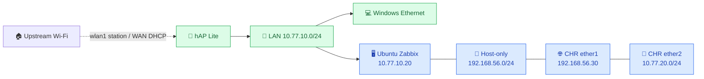

# 🏗️ Network Architecture
 

> [!IMPORTANT]
> This is the **Phase 0.3 conceptual design**. Link behavior, IP assignments and service operation are not yet validated on the proposed custom network.

## 🧱 Core components

| 🏠 Physical / host | 🖥️ Virtual / monitoring |
|:---|:---|
| Windows 11 laptop, 12 GB RAM | Ubuntu Server 24.04 LTS, Zabbix 7.0 LTS preferred pending installation check |
| hAP Lite with wireless `wlan1` WAN | VirtualBox Bridged NIC on Ethernet for Zabbix LAN |
| Wi-Fi home upstream: 2.4 GHz WPA2/CCMP | VirtualBox Host-only NIC for CHR management |
| LAN via MikroTik Ethernet bridge | MikroTik CHR via VirtualBox integration with GNS3 |

## 🗺️ Logical connections

## 🔀 Network roles

| Segment | Design role | Routing requirement |
|:---|:---|:---|
| `10.77.10.0/24` | Physical LAN / Zabbix internet and hAP Lite monitoring | Default route via `10.77.10.1` for Internet |
| `192.168.56.0/24` | VirtualBox host-only CHR management | Directly connected between configured VM NICs; no extra default gateway |
| `10.77.20.0/24` | CHR simulation subnet | Routing and return path required if monitoring hosts behind CHR |

## ⚠️ Validation gates

| Risk / dependency | Planned validation |
|:---|:---|
| Wi-Fi WAN station association | Validate WPA2 and routing in Phase 1 |
| Custom LAN vs existing default config | Backup, phased change and security testing |
| Bridged VirtualBox to physical Ethernet | Confirm VM reaches hAP Lite and Internet in Phase 2 |
| Host-only IPv4 mismatch | Correct and verify before using CHR management network |
| RAM/storage pressure | Deploy gradually and measure actual usage |
| Multi-subnet reachability | Check return route and firewall before incident tests |

## 📦 Rebuildability

The final repository is planned to include tested, sanitized `.rsc` examples, GNS3 wiring guidance, installation steps, and connectivity tests. **This diagram alone is not a runnable lab.**
