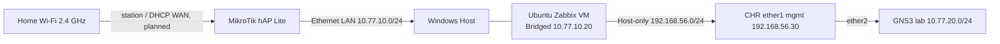

# Planned Architecture — Phase 0.3

> **Status: Proposed design, not a deployed or tested topology.**

## Components

- Host: Windows 11 Home, 12 GB RAM, VirtualBox 7.2.14, GNS3 2.2.61 (observed at assessment).
- Physical device: MikroTik hAP Lite (RouterOS 7.20.7 observed at assessment).
- Upstream: home 2.4 GHz WPA2-Personal/CCMP Wi-Fi as a potential routed WAN (`wlan1`, station mode).
- LAN: MikroTik bridge over selected Ethernet ports, with source NAT on wireless WAN, appropriate firewall and admin hardening.
- Monitoring VM: Ubuntu Server 24.04 LTS with Zabbix (7.0 LTS preferred pending compatibility check).
- VM interfaces: bridged to laptop physical Ethernet for physical-router monitoring and internet through MikroTik; host-only for virtual CHR management. One default route via physical LAN gateway.
- GNS3: existing VirtualBox-integrated CHR method; optional additional CHR/Linux monitored host only if resources permit.

## Connectivity diagram

*The drawing expresses logical relationships. Ubuntu is hosted on Windows; it does not have a separate physical Ethernet cable.*

## Design and risks

1. **Do not implement Phase 0 networking changes prematurely.** Custom configuration belongs to Phase 1.
2. hAP Lite wireless is 2.4 GHz; association and WPA2 interoperability must still be tested.
3. VirtualBox bridged networking over the physical Ethernet must be proven; host-only adapter currently has a mismatched IPv4 configuration and requires correction at implementation.
4. CHR management and Zabbix host-only IPs may communicate via automatically connected route; no extra gateway on host-only.
5. The proposed physical LAN and virtual LAN are different subnets. Monitoring behind CHR requires an explicit routing/return path and firewall review.
6. Host internet availability/metrics may change during transition; avoid dual default-route ambiguity.
7. Limit VM concurrency until actual host memory consumption is measured.

## Rebuildability

Later phases will produce tested setup instructions, redacted configurations, network validation commands and expected results. A diagram alone is not a runnable lab.
